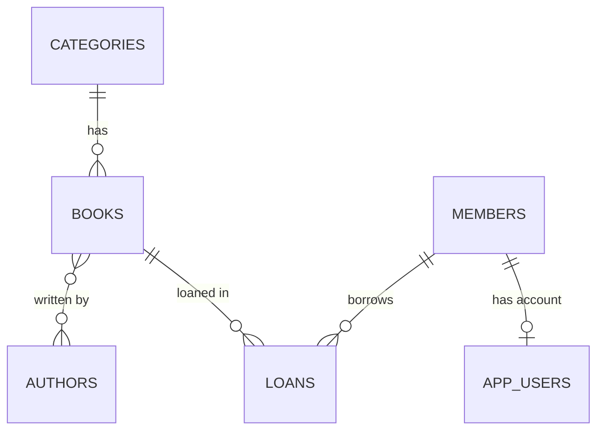

# Perpustakaan - Library Management REST API

A small library management backend built with Spring Boot. It keeps track of books, authors, categories, members, and loans, and enforces one business rule: **a book that is currently on loan cannot be borrowed again until it is returned.**

Endpoints are protected with JWT authentication and two roles (`MEMBER` and `ADMIN`). The API is documented with Swagger UI.

Built as a hands-on project to practice relational modeling (one-to-many, many-to-many, a join entity with extra columns), REST API design, authentication, unit testing, and containerization.

## Tech stack

- Java 17, Spring Boot 4, Spring Data JPA (Hibernate)
- Spring Security with JWT (OAuth2 resource server, HS256)
- springdoc OpenAPI (Swagger UI)
- PostgreSQL 16
- Docker and Docker Compose
- JUnit 5 and Mockito
- Maven

## Data model



- `books` belong to one `category` and can have many `authors` (join table `book_authors`).
- `loans` connect a `member` to a `book` and carry their own data: loan date, due date, and return date. A loan with no return date is still active.
- `app_users` hold login credentials (BCrypt password hash) and a role. A user registered through the API is linked to its own `member` record.

## Business rules

- A book can only have one active loan at a time. This is checked in `LoanService` and also enforced by a partial unique index in PostgreSQL.
- A loan is due 14 days after it is created.
- A loan counts as `OVERDUE` when it is past its due date and not yet returned.
- Returning a book that was already returned is rejected.
- ISBNs are unique.
- Only `ADMIN` can add books.
- A `MEMBER` can only borrow for themselves and can only return their own loans. An `ADMIN` can do both for any member.

## Configuration

The application requires the following environment variables (never commit them):

| Variable | Purpose |
|---|---|
| `JWT_SECRET` | Key used to sign JWT tokens, at least 32 characters. Generate one with `openssl rand -base64 32` |
| `ADMIN_PASSWORD` | Password for the admin account, created automatically on first startup |
| `ADMIN_USERNAME` | (optional) Admin username, defaults to `admin` |

When running locally without Docker, the database connection is read from `SPRING_DATASOURCE_URL`, `SPRING_DATASOURCE_USERNAME`, and `SPRING_DATASOURCE_PASSWORD`.

## Run it

Requirements: Docker with Docker Compose.

Put `JWT_SECRET` and `ADMIN_PASSWORD` in a `.env` file next to `docker-compose.yml`, then:

```bash
docker compose up -d --build
```

The API is available at `http://localhost:8080`. Hibernate creates the tables on first start. Then load sample data and the loan rule index:

```bash
docker exec -i perpustakaan-db psql -U perpus -d perpustakaan < sql/seed.sql
```

Stop everything with `docker compose stop`. Do not use `docker compose down -v` unless you want to delete the data.

### Run without Docker for the app (development)

Only the database runs in Docker, the app runs with Maven:

```bash
docker compose up -d db
set -a; source .env; set +a
./mvnw spring-boot:run
```

## Authentication

- `POST /auth/register` creates a user and a member record (role: `MEMBER`). Password must be at least 8 characters.
- `POST /auth/login` returns a JWT, valid for 1 hour.
- Send the token in the `Authorization: Bearer <token>` header.
- An invalid or expired token is rejected with 401, even on public endpoints.
- The admin account is created on first startup from `ADMIN_USERNAME` and `ADMIN_PASSWORD`.

## API documentation

Swagger UI: `http://localhost:8080/swagger-ui/index.html`

Log in with `POST /auth/login`, click **Authorize**, and paste the token (without the word `Bearer`).

## API

| Method | Endpoint | Access | Description |
| --- | --- | --- | --- |
| POST | `/auth/register` | Public | Create a user and a member record |
| POST | `/auth/login` | Public | Get a JWT |
| GET | `/books` | Public | List books (paginated, filterable) |
| GET | `/books/{id}` | Public | Get one book |
| POST | `/books` | ADMIN | Add a book |
| GET | `/loans` | ADMIN | List all loans with status |
| POST | `/loans` | MEMBER, ADMIN | Borrow a book |
| PUT | `/loans/{id}/return` | Loan owner, ADMIN | Return a book |

Errors come back as JSON, for example `{"status":409,"message":"..."}`. Status codes used: 400 (invalid input), 401 (missing or invalid token), 403 (not allowed), 404 (not found), 409 (conflict, such as a book that is already on loan).

### Searching books

`GET /books` accepts optional query parameters:

| Parameter | Default | Description |
| --- | --- | --- |
| `title` | (none) | Partial title match, case-insensitive |
| `categoryId` | (none) | Filter by category id |
| `page` | `0` | Page number, starting at 0 |
| `size` | `10` | Items per page (1 to 100) |
| `sortBy` | `id` | `id`, `title`, or `publicationYear` |
| `direction` | `asc` | `asc` or `desc` |

The response is a page object:

```json
{
  "content": [ { "id": 2, "title": "Clean Code", "isbn": "9780132350884", "publicationYear": 2008, "category": "Teknologi", "authors": ["Robert C. Martin"] } ],
  "page": 0,
  "size": 10,
  "totalElements": 1,
  "totalPages": 1
}
```

### Examples

```bash
# log in and keep the token
TOKEN=$(curl -s -X POST http://localhost:8080/auth/login \
  -H "Content-Type: application/json" \
  -d '{"username":"admin","password":"YOUR_ADMIN_PASSWORD"}' | sed 's/.*"token":"\([^"]*\)".*/\1/')

# search books (public)
curl -s "http://localhost:8080/books?title=clean&size=5"

# add a book (ADMIN, use real category and author ids from your database)
curl -s -X POST http://localhost:8080/books \
  -H "Authorization: Bearer $TOKEN" -H "Content-Type: application/json" \
  -d '{"title":"Refactoring","isbn":"9780134757599","publicationYear":2018,"categoryId":2,"authorIds":[3]}'

# borrow a book as admin (memberId is required for admin, members borrow for themselves)
curl -s -X POST http://localhost:8080/loans \
  -H "Authorization: Bearer $TOKEN" -H "Content-Type: application/json" \
  -d '{"memberId":1,"bookId":1}'

# return a loan
curl -s -X PUT http://localhost:8080/loans/1/return -H "Authorization: Bearer $TOKEN"
```

## Tests

Unit tests for the loan rules run without a database:

```bash
./mvnw test -Dtest=LoanServiceTest
```

Running `./mvnw test` also runs the Spring context test, which needs PostgreSQL running and the environment variables above loaded (`docker compose up -d db`).

## Project structure

```
src/main/java/com/vanxx/library
  config       security, JWT, OpenAPI, admin account seeding
  controller   REST endpoints
  service      business rules
  repository   Spring Data JPA repositories
  entity       JPA entities
  dto          request and response objects
  exception    JSON error handling
sql/seed.sql   sample data and the active-loan index
```